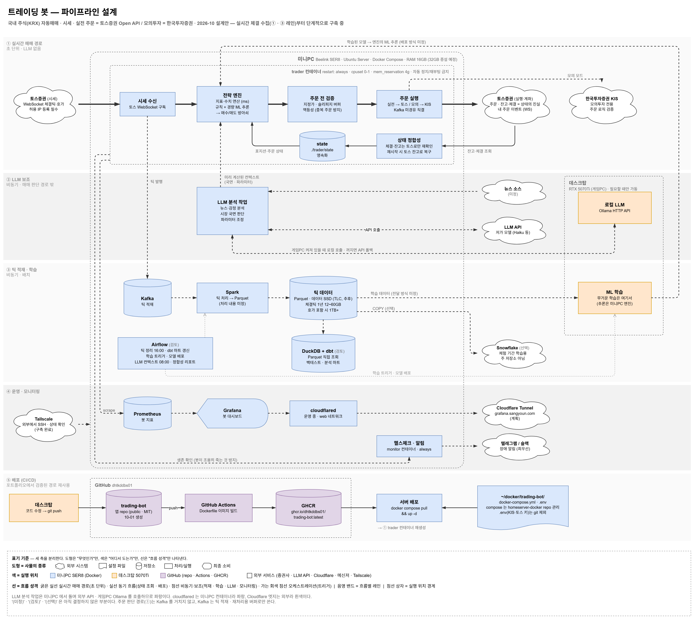

# trading-bot

홈서버(미니PC)에서 상시 구동할 **국내 주식(KRX) 자동매매 봇**입니다.
돈이 걸리는 주문 기능은 마지막에 붙이고, **실시간 체결 데이터를 받아 쌓는 수집 파이프라인부터** 단계적으로 만들고 있습니다.

> 🚧 **진행 중** — 미니PC 가 평일 장중 체결을 자동으로 Kafka 에 쌓고 있고(2026-10-29~), 5단계(Spark bronze)를 진행합니다. 실전 주문 기능은 아직 없습니다.

## 아키텍처



| 레인 | 하는 일 | 상태 |
|---|---|---|
| ① 실시간 매매 | 토스 WebSocket 체결 → 전략 엔진 → 주문 전 검증 → 주문 실행. 체결 · 잔고는 토스로만 재확인 | 수신 · 구독 ✅ / 엔진 · 주문 미착수 |
| ② LLM 보조 | 뉴스 · 시장 국면 분석을 **비동기**로 미리 계산해 엔진에는 컨텍스트로만 전달 | 설계 |
| ③ 틱 적재 · 학습 | 체결틱 → Kafka → Spark → Parquet(bronze · silver · gold). 장 마감 후 배치는 Airflow 가 묶음. ML 학습은 데스크탑(GPU), 추론은 미니PC | 서버 Kafka 적재 ✅ (10-29~) / Spark 가공 진행 중 |
| ④ 운영 · 모니터링 | Prometheus · Grafana · 헬스체크 알림 | 설계 |
| ⑤ 배포 | GitHub Actions → GHCR → 서버 `docker compose pull` | 다른 프로젝트에서 검증된 경로 재사용 예정 |

`(미정)` · `(검토)` · `(선택)` 표시는 아직 결정하지 않은 부분입니다.

## 설계 원칙

- **시세 · 주문 · 계좌는 토스증권 하나로.** 시세와 주문을 서로 다른 증권사에서 받으면 체결가 괴리, 종목코드 매핑 같은 문제가 생깁니다. 토스 공식 문서에는 모의투자 언급이 없어서, 주문 로직 검증만 **한국투자증권 모의투자**로 합니다.
- **주문 판단 경로에는 LLM · Kafka · Spark · Airflow 를 넣지 않습니다.** LLM 응답은 초 단위로 느리고, Kafka 나 배치 도구의 장애가 매매를 멈추게 하면 안 됩니다. 전략 엔진은 WebSocket 으로 받은 틱을 메모리에서 바로 계산하고, Kafka 는 틱 적재 · 재처리(replay)용 버퍼로만 씁니다.
- **원본부터 남깁니다.** 받은 체결 메시지는 파싱하기 전 원본을 그대로 bronze 에 보존합니다. 파싱 로직이 틀리면 코드를 고친 뒤 Airflow backfill 로 과거 날짜의 silver · gold 를 원본에서 다시 만듭니다. 틱 단위 과거 데이터는 나중에 다시 받을 수 없어 일찍 쌓을수록 자산이 됩니다.
- **한 대로 시작하고, 확장 경로는 열어 둡니다.** 소수 종목 체결틱은 1년에 수십 GB 수준(2종목 실측 하루 44~68만 건 · Kafka 디스크 약 120MB → 1년 약 30GB)이라 미니PC 한 대로 충분합니다. 대신 Kafka 메시지 key 를 종목코드로 나누고 저장은 Parquet 으로 해서, 종목이 늘면 consumer 와 Spark 작업만 늘리면 되게 합니다.
- **토큰은 저장해서 재사용합니다.** 토스는 클라이언트당 유효한 토큰이 1개뿐이라(새로 발급하면 이전 토큰은 무효), 실행할 때마다 발급하면 다른 프로세스의 연결이 끊깁니다.
- **조용히 틀리지 않습니다.** 모든 요청에 `timeout` 과 응답 상태 확인을 넣고, 필수 설정값이 없으면 그 자리에서 에러를 냅니다.

## 진행 상황

| 단계 | 내용 | 상태 |
|---|---|---|
| 1 | 개발 환경 — venv · `.env` 분리 · 키 커밋 차단 | ✅ |
| 2 | 토스 토큰 발급(캐시) → REST 현재가 조회 | ✅ |
| 3 | WebSocket 실시간 체결 구독 — 10-08 장중 2종목 43.6만 건 수신, 끊김 없음 | ✅ |
| 4 | Kafka 적재 — 수신기가 종목코드를 key 로 produce, 전송 실패 시 로컬 파일로 보존 (10-29 · 30 실측: 하루 49~68만 건, 수신 = 적재 일치, 유실 0) | ✅ |
| 5 | Spark bronze — Kafka 메시지를 원본 그대로 Parquet 저장 (체크포인트 · 날짜 파티션) | 🔄 Spark Standalone 클러스터 — 마스터 · 워커 2(각 2코어 · 2GB) ✅ (데스크탑) · Kafka 연결 · MinIO · bronze 남음 |
| 6 | 서버 컨테이너로 평일 장중 상시 수집 (수신기 · Kafka · bronze) | 🔄 수신기 · Kafka 서버 상시 수집 ✅ (10-29~, 5단계보다 먼저) · bronze 대기 |
| 7 | Spark silver · gold — 파싱한 체결 → 1분봉 · 학습용 피처 | ⏳ |
| 8 | Airflow DAG — 휴장일 확인 → bronze → silver → gold → 품질 검사, 과거 날짜 backfill | ⏳ |
| 이후 | 전략 엔진 → 모의 주문 검증 → 실주문(소액) → 모니터링 | ⏳ |

## 기술 스택

| 구분 | 사용 중 | 계획 · 검토 |
|---|---|---|
| 언어 · 라이브러리 | Python 3.12 · requests · websockets · python-dotenv · confluent-kafka | PySpark |
| 데이터 | Kafka 4.3.1 (KRaft · 로컬 Docker Compose) | Spark Standalone 클러스터 (마스터 · 워커 2 · 공유 저장소 MinIO, Structured Streaming · 배치) · Parquet (bronze · silver · gold) · DuckDB + dbt(검토) |
| 오케스트레이션 | — | Airflow (장 마감 후 배치 DAG) |
| 인프라 | Docker · Docker Compose | GitHub Actions · GHCR · Prometheus · Grafana |
| 외부 API | 토스증권 Open API (REST · WebSocket) | 한국투자증권 Open API (모의투자) |

## 구조

```
trading-bot/
├── src/
│   └── exchange/
│       ├── toss.py          # 토큰 발급(24시간 캐시 · 401 이면 1회 재발급) · 현재가 조회
│       └── web_socket.py    # 실시간 체결 구독 · 60초마다 PING · 끊기면 재연결 · Kafka(ticks.raw)로 produce, 실패 시 data/fallback/
├── jobs/
│   └── bronze.py            # Kafka → bronze Parquet (작성 중, Spark 클러스터에서 실행)
├── docker-compose.yml       # Kafka(상시, 주소 2개 · 볼륨) + 수신기(서버, 장 시간) + Spark 마스터 · 워커 2
├── Dockerfile               # 수신기 이미지 (python:3.12-slim)
├── docs/architecture.png    # 파이프라인 설계도
├── .env.example             # 필요한 키 이름 (값 없음)
└── requirements.txt
```

## 실행

```powershell
# 1) 가상환경 + 라이브러리  (Linux/macOS 는 source .venv/bin/activate)
python -m venv .venv
.\.venv\Scripts\Activate.ps1
pip install -r requirements.txt

# 2) 키 설정 — .env.example 을 복사해 값을 채운다 (.env 는 git 에서 제외)
Copy-Item .env.example .env
#    토스증권 WTS > 설정 > Open API 에서 client_id · client_secret 발급,
#    실행하는 PC 의 공인 IP 를 '허용 IP' 로 등록해야 호출된다

# 3) 현재가 조회
python -m src.exchange.toss 005930 000660

# 4) 로컬 Kafka — docker compose 로 띄우고, 처음 한 번만 토픽을 만든다
docker compose up -d kafka
docker exec kafka /opt/kafka/bin/kafka-topics.sh --bootstrap-server localhost:9092 `
  --create --topic ticks.raw --partitions 6 --replication-factor 1

# 5) 실시간 체결 구독 → Kafka(ticks.raw) 로 보냄 — 장중에 체결이 들어온다 (Ctrl+C 로 종료)
#    Kafka 로 못 보낸 원본은 data/fallback/ticks_날짜.jsonl 에 남는다
python -m src.exchange.web_socket 005930 000660

# 6) Kafka 에 쌓인 메시지 보기
docker exec -it kafka /opt/kafka/bin/kafka-console-consumer.sh --bootstrap-server localhost:9092 `
  --topic ticks.raw --from-beginning --property print.key=true

# 7) (5단계) Spark Standalone 클러스터 — 마스터 1 · 워커 2 (데스크탑에서 구축 중)
docker compose up -d spark-master spark-worker-1 spark-worker-2
#    http://localhost:8080 에서 워커 2개가 ALIVE 인지 확인 → 예제 작업을 클러스터에 보내기
docker compose exec spark-master /opt/spark/bin/spark-submit --master spark://spark-master:7077 `
  /opt/spark/examples/src/main/python/pi.py 20
```

`src` 안의 모듈끼리 불러오기 때문에 파일 경로가 아니라 **repo 루트에서 `python -m`** 으로 실행합니다.

### 서버(미니PC) 상시 수집

데스크탑을 켜 두지 않아도 되게, 서버에서 Kafka 는 상시 · 수신기는 평일 장 시간에만 돕니다. 수신기는 컨테이너 안에서 `kafka:19092` 로 붙고, 끊기면 5초부터 최대 60초 간격으로 다시 연결합니다.

```bash
# 처음 한 번 (서버의 .env 에 토스 키가 있어야 한다)
docker compose up -d kafka
docker exec kafka /opt/kafka/bin/kafka-topics.sh --bootstrap-server localhost:9092 \
  --create --topic ticks.raw --partitions 6 --replication-factor 1 \
  --config retention.ms=-1          # bronze 가 매일 돌기 전까지는 원본을 지우지 않는다
docker compose build receiver

# 코드를 바꾼 뒤
git pull && docker compose build receiver

# crontab — 평일 08:55 시작 · 15:55 종료 (서버 시간대가 KST)
55 8  * * 1-5  cd ~/trading-bot && docker compose up -d receiver
55 15 * * 1-5  cd ~/trading-bot && docker compose stop receiver

# 확인
docker compose logs --tail 20 receiver
```

⚠️ 수신기가 도는 동안(평일 08:55~15:55) 데스크탑에서 토스 API 를 부르면 토큰이 새로 발급돼 서버 쪽 토큰이 무효가 됩니다(클라이언트당 토큰 1개). 서버는 401 을 받으면 토큰을 새로 받아 다시 붙지만, 그 순간 데스크탑 토큰이 무효가 됩니다.

## 보안

- 키는 `.env` 에만 두고 git 에 올리지 않습니다(`.gitignore`). `.env.example` 에는 키 이름만 있습니다.
- 로컬 pre-commit 훅으로 키 값이 들어간 변경은 커밋되지 않게 막습니다.
- 토스 API 는 등록한 허용 IP 에서만 호출됩니다.

## 주의

개인 학습 · 포트폴리오용 저장소입니다. 투자 권유가 아니며, 이 코드를 사용해 생긴 손실의 책임은 사용자에게 있습니다.

## License

MIT
